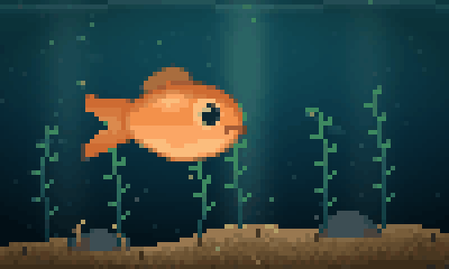

<div align="center">

# 🐟 大肥鱼 · fatfish

**一条住在你终端里的鱼。**

一行命令，它就游起来了。零依赖、真彩色、还能喂。

<a href="#一行安装"></a>
= 16">


<picture>
  <source srcset="assets/preview.webp" type="image/webp">
  
</picture>

</div>

---

## 一行安装

不用装，直接看：

```bash
npx github:qpzmas/siokhfd
```

想把它留在电脑里，以后随时叫出来：

```bash
npm i -g github:qpzmas/siokhfd
fatfish
```

macOS / Linux 也可以用一行脚本（只下载单个 .mjs 文件，不碰 npm 全局）：

```bash
curl -fsSL https://raw.githubusercontent.com/qpzmas/siokhfd/main/install.sh | bash
```

Windows（PowerShell）：

```powershell
irm https://raw.githubusercontent.com/qpzmas/siokhfd/main/install.ps1 | iex
```

> 只需要 Node.js ≥ 16。没有依赖、没有安装包、没有 `node_modules`。
> 终端要支持真彩色（Windows Terminal、iTerm2、Kitty、WezTerm、VS Code 终端都可以）。

## 怎么玩

| 按键 | 干什么 |
| :--- | :--- |
| `空格` / `f` | 撒一把鱼食 —— 它会自己追过去吃 |
| `n` | 白天 ⇄ 夜晚，星星会亮起来 |
| `r` | 重新开始（鱼重新变瘦） |
| `q` | 退出（终端会还原） |

喂得越多，它越圆。吃到东西的瞬间会冒爱心、吐泡泡、嘴巴张一下；
闲着的时候它会眨眼、摆尾、扇鳍，腮帮子红红的，嘴角还带着笑。

## 它会自己做的事

- 饿的时候盯着最近的鱼食游，吃饱了就在水里慢慢晃
- 会眨眼（随机 2~6 秒一次），尾巴按游速摆，胸鳍一直在扇
- 水草随水流摇，气泡一串串往上冒，远处有几条小鱼经过
- 按 `n` 之后，水面变蓝、星星闪烁、沙底和珊瑚一起暗下去
- 终端窗口改大小，它也跟着重新布置水草和石头

## 命令行参数

| 参数 | 说明 |
| :--- | :--- |
| `--once` | 只画一帧就退出（截图 / 放进 CI 冒烟测试） |
| `--night` | 从夜晚开始 |
| `--fps <n>` | 帧率，默认 30 |
| `--width <n>` `--height <n>` | 手动指定画布大小（字符格） |
| `--seed <n>` | 固定随机种子，每次长得一样 |
| `--record <path>` | 把像素帧录成 `<path>.bin` + `<path>.json` |
| `-h, --help` | 帮助 |

## 它是怎么画出来的

终端里一个字符格其实是**两个像素**：上半格用前景色、下半格用背景色，
两个颜色都塞进 `▀` 这一个字符里。所以 100×30 的窗口，
等于一块 **100×60 的像素画布**。

- 颜色是 24 位真彩（`\x1b[38;2;r;g;bm` / `\x1b[48;2;r;g;bm`），不是 256 色
- 鱼、水草、气泡、珊瑚、暗角全是代码算出来的：椭圆、正弦、径向渐变
- 每帧只重发变化的颜色码，配合 `\x1b[?2026h` 同步刷新，尽量不闪
- 一个文件、零依赖、不到 40 KB

## 卸载

```bash
npm uninstall -g siokhfd
```

用 curl 装的，删掉 `~/.local/bin/fatfish` 就行。

## License

MIT © qpzmas
